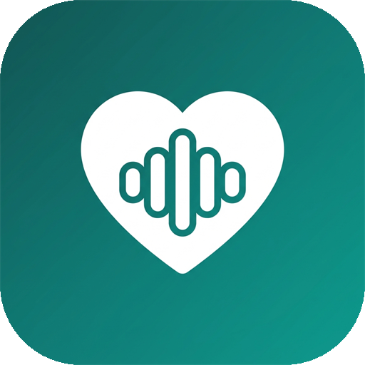
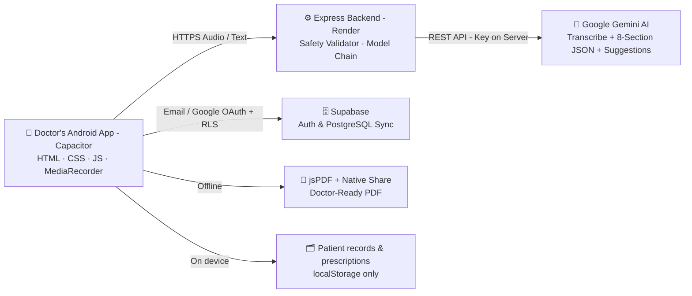

<div align="center">
  
  <h1>🩺 VoiceCare</h1>
  <p><strong>AI-Powered Clinical Intake Assistant for Indian Doctors</strong></p>
  <p><em>"Record the complaint. Get an English summary and symptoms to ask about."</em></p>

  %20%7C%20Web-0F766E)
  
  
  

  <br /><br />
  <a href="https://github.com/NikhilK-1007/Voice-Care/releases">
    
  </a>
</div>

---

## ✨ Why VoiceCare?

In busy Indian clinics, a consultation starts with the patient explaining their complaint — often in Kannada, Hindi, or a mix of languages — while the doctor writes notes in English.

**VoiceCare is a doctor's tool.** The clinician records what the patient says in any language, and VoiceCare turns it into a clean **English 8-section summary**, plus a short list of **possible symptoms to ask about**. It never diagnoses, never prescribes, and never mixes its suggestions into the patient's own words.

---

## 🧭 Architecture Overview



---

## 🚀 Key Features

| Category | What VoiceCare Delivers |
| --- | --- |
| 👩‍⚕️ **Built for doctors** | Intake, summary, patient records and PDFs are all written and laid out for the clinician, not the patient. |
| 🎙️ **In-App Voice Input** | Built-in `MediaRecorder` (`32 kbps` mono Opus, up to 60s) posts to `/api/transcribe` over HTTPS; raw audio buffers are cleared immediately after transcription and never saved to disk. |
| 🌐 **Any Language → English Summary** | UI in **English, हिन्दी, ಕನ್ನಡ** + automatic detection of any Indian language or transliteration. Exactly one English summary is shown, stored for display and printed — never a second-language version. |
| 📋 **8-Section Clinical Summary** | *Main Concern, Symptoms, Duration, Severity, Medical History, Current Medications, Observations, Questions to Ask*. |
| 🔎 **Possible Symptoms (AI)** | Up to 6 common companion symptoms for the complaint (e.g. fever → chills, body ache, tiredness) shown in a separate amber panel, labelled as AI suggestions to confirm with the patient — also printed as their own PDF block. |
| 🛡️ **Strict Healthcare Safety** | Never diagnoses or prescribes. Unmentioned fields stay `"Not mentioned by patient"`. Red-flag words the patient actually said surface clickable **108 / 112** helplines. |
| 🗂️ **Patient Records** | Add patients one at a time; saving shows the saved card instead of the empty form. Switch the **active patient**, edit, delete, and use the active patient's details on every summary and PDF. |
| 📎 **Prescription Intake** | Attach prescriptions from **Photos**, **Camera** or **Document** (PDF/image), WhatsApp-style. Images are shrunk to 900 px; up to 6 files per patient, stored on the phone only. |
| ✏️ **Edit & Confirm Gate** | The doctor reviews and edits every English section and confirms accuracy before sharing. |
| 📄 **Offline PDF & Sharing** | Client-side `jsPDF` (`v4.2+`) report, Android native Share sheet (`@capacitor/share`), and one-tap clipboard copy. |
| 🕒 **Doctor View, Notes & Timeline** | Consultation list with review state, per-visit notes (advice, medicines, next visit), and a month-grouped timeline. |
| 🔐 **Guest Mode + Cloud Auth** | Zero-setup Guest Mode, or Supabase Email/Password + Google OAuth with password recovery and cross-device sync of summaries and the active patient card. Patient records and prescriptions stay device-local. |
| ♿ **Accessibility & UX** | Warm cream & forest-teal editorial design, 3-way *Text Size*, *High Contrast*, *Calm Display*, and native Android back-button exit from Home. |
| 📴 **Offline-safe** | Offline banner, draft protection for the recorded complaint, and local records usable without a connection. |

> **Removed by design:** the QR code and read-only doctor web page (`/api/share`, `/s/:token`), the follow-up questions screen, the medicine reminder feature, and dual-language summaries.

---

## 📲 Doctor Workflow

1. **Welcome & Mode** — Start in **Guest Mode** or sign in with **Email / Google**.
2. **Patients** — Tap **Add patient**, fill name, age, gender, blood group, allergies and emergency contact.
3. **Prescription** — Attach the prescription with **Photos**, **Camera** or **Document**, then **Save information**. The saved patient card replaces the form and becomes the active patient.
4. **Record** — Open a new consultation and record the patient's complaint in any language (or type it).
5. **AI Summary** — VoiceCare writes one English 8-section summary and a separate list of possible symptoms to ask about.
6. **Review & Confirm** — Correct any section, confirm, and share the PDF or plain text.

---

## 📁 Project Folder Structure

```text
Voice-Care/
├── backend/
│   ├── package.json              # Express, CORS, Helmet, dotenv, rate-limit
│   ├── .env.example              # Environment variable template (copy to .env)
│   ├── server.js                 # Express server, middleware & static frontend hosting
│   ├── routes/
│   │   ├── summary.js            # POST /api/summarize & /api/regenerate
│   │   ├── followup.js           # POST /api/follow-up (kept for tests; no UI uses it)
│   │   └── transcribe.js         # POST /api/transcribe (base64 audio -> text)
│   ├── services/
│   │   ├── geminiService.js      # Gemini model chain, English pass, suggestions, demo fallback
│   │   └── safetyValidator.js    # Schema enforcement, script detection, 108/112 checks
│   └── tests/
│       └── api.test.js           # Node built-in test suite (9/9 passing)
├── frontend/
│   ├── package.json              # Capacitor 6 Android + plugins + jsPDF
│   ├── capacitor.config.json     # Capacitor config (appId: in.voicecare.app)
│   ├── scripts/
│   │   └── copy-vendor.js        # Copies jsPDF to www/vendor/ for offline PDFs
│   ├── android/                  # Native Capacitor Android project
│   └── www/
│       ├── index.html            # Mobile screens: home, intake, patients, history, doctor view…
│       ├── assets/               # App launcher logo (logo.svg, logo.png) & splash-mark.svg
│       ├── css/styles.css        # Warm cream, forest-teal & saffron accessible UI system
│       └── js/
│           ├── config.js         # Backend API_BASE_URL & Supabase client config
│           ├── i18n.js           # English, Hindi & Kannada UI translations
│           ├── voice.js          # In-app MediaRecorder voice capture
│           ├── api.js            # Fetch wrappers (/api/health, /summarize, /transcribe)
│           ├── supabase.js       # Email + Google OAuth + PostgreSQL cloud sync
│           ├── storage.js        # Patients, prescriptions, visit history & settings
│           ├── pdf.js            # Offline jsPDF generation & Capacitor Share
│           └── app.js            # Navigation & screen controllers
├── supabase/schema.sql           # summaries table + RLS policies
├── docs/SUPABASE-SETUP.md        # Step-by-step database setup
├── PHASE1.md / PHASE2-3.md       # Build notes and demo script
├── Dockerfile                    # Lightweight Node 20 Alpine container image
├── docker-compose.yml            # One-command startup (no secret keys required)
├── .dockerignore
└── README.md
```

---

## 🛠️ Local Setup & Running

### Prerequisites
- **Option A (Docker):** [Docker Desktop](https://www.docker.com/products/docker-desktop/) — starts in one command with zero secret keys.
- **Option B (Local Node):** **Node.js v18+** ([nodejs.org](https://nodejs.org/))
- *(Optional)* **Google Gemini API Key** ([aistudio.google.com/apikey](https://aistudio.google.com/apikey)) — **not required to run**: the app starts without any secret keys using the built-in demo fallback (which still produces English summaries and possible-symptom suggestions).

### 1️⃣ Quick Start with Docker Compose (No Keys Required)
```bash
docker compose up --build
```
Open **`http://localhost:3000`** once started (or pass an optional key: `GEMINI_API_KEY=your_key docker compose up --build`).

### 2️⃣ Or Start Backend Directly with Node.js (Zero-Config)
```bash
cd backend
npm install
npm start     # Starts immediately at http://localhost:3000 (no .env required)
npm test      # Runs automated validation & API tests (9 tests)
```
*(On Windows PowerShell, use `npm.cmd` if `npm.ps1` is blocked by execution policy.)*

*(Optional)* To run your own local Gemini key instead of demo fallback, copy `backend/.env.example` to `backend/.env`:
```env
PORT=3000
GEMINI_API_KEY=your_actual_gemini_api_key
GEMINI_MODEL=gemini-3.8-flash
ALLOW_DEMO_FALLBACK=true
ALLOWED_ORIGINS=*
```

### 3️⃣ Prepare Frontend Assets & Preview in Browser
```bash
cd frontend
npm install
npm run prepare:vendor
```
The backend serves `frontend/www` at **`http://localhost:3000`**. Press `F12` → `Ctrl + Shift + M` to preview in mobile viewport mode.

---

## 🤖 Android APK Download & Build

- **Download Pre-Built APK:** Get `VoiceCare-debug.apk` directly from [GitHub Releases](https://github.com/NikhilK-1007/Voice-Care/releases).

### Build from Source

| Component | Version |
| --- | --- |
| **JDK** | Temurin 21 (`$LOCALAPPDATA/VoiceCareTools/jdk21`) |
| **Gradle / AGP** | Gradle `8.7` · Android Gradle Plugin `8.2.1` |
| **Android SDK** | `compileSdk` / `targetSdk 34` |

```bash
cd frontend
npm run prepare:vendor
npx cap sync android
cd android
export JAVA_HOME="$LOCALAPPDATA/VoiceCareTools/jdk21"
./gradlew.bat assembleDebug
```
The built APK is generated at `frontend/android/app/build/outputs/apk/debug/app-debug.apk`.

To install on a USB-connected phone:
```bash
adb install -r path/to/app-debug.apk
```

---

## ☁️ Backend Deployment (Render), Security & Cloud Auth (Supabase)

- **Backend Hosting:** Deployed on **Render** (`Root Directory: backend`, Region: `Singapore`, Build: `npm install`, Start: `npm start`, Env Var: `GEMINI_API_KEY`). Render redeploys from `main`. `API_BASE_URL` in `frontend/www/js/config.js` points to the live HTTPS backend.
- **Database & Auth:** Uses **Supabase** (`public.summaries` table with `text` primary key and Row-Level Security `select`/`insert`/`update`/`delete` policies for `authenticated` users matching `auth.uid() = user_id`), supporting Email/Password sign-in & sign-up, password reset recovery, Google OAuth via `in.voicecare.app://auth-callback`, and live status/manual sync under **Settings → Cloud backup & sync**. Patient identity/records and prescriptions are not uploaded; only the active patient card is kept alongside the account.
- **Security & Reliability Hardening:** Server-side `GEMINI_API_KEY`, Helmet CSP & security headers, strict CORS allow-list, per-IP rate limiting (`30 req/min` API, `15 req/min` `/api/transcribe`), `Cache-Control: no-store` on patient audio/summary responses, abortable client fetch timeouts with concurrent-request cancellation, non-blocking offline-first startup, and `0` production npm vulnerabilities.

---

## 🩺 Healthcare Safety Commitments

- ❌ **Never** diagnoses diseases or medical conditions.
- ❌ **Never** prescribes medicines or recommends dosages.
- ❌ **Never** invents symptoms, timelines, or medical history (`"Not mentioned by patient"` is enforced when absent).
- ✅ **Possible symptoms** are the single, clearly-labelled exception: they are shown apart from the patient's words, described as AI suggestions to confirm, and never folded into the summary or treated as findings.
- ✅ **Always** labels summaries as communication aids—not verified medical records.
- 🚨 **Always** surfaces India emergency numbers (**108 / 112**) when urgent red-flag words appear in what the patient said.
