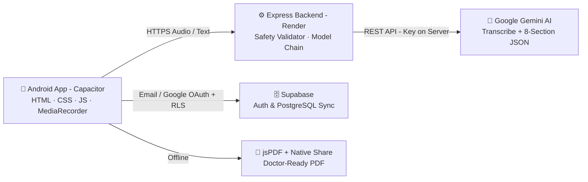

<div align="center">
  
  <h1>🩺 VoiceCare</h1>
  <p><strong>AI-Powered Voice-First Healthcare Communication Assistant for Indian Patients</strong></p>
  <p><em>"Speak naturally. Let AI organise. Help your doctor understand."</em></p>

  %20%7C%20Web-0F766E)
  
  
  

  <br /><br />
  <a href="https://github.com/NikhilK-1007/Voice-Care/releases">
    
  </a>
</div>

---

## ✨ Why VoiceCare?

In busy Indian clinics, patients—especially elderly individuals and those uncomfortable typing—often struggle to explain symptoms clearly within a short consultation.

**VoiceCare** lets patients speak or type naturally in **Kannada, Hindi, English, or any other Indian language**, then uses **Google Gemini AI** to organise their words into a clean, **8-section doctor-friendly English summary**—without diagnosing, prescribing, or inventing missing information.

---

## 🧭 Architecture Overview



---

## 🚀 Key Features

| Category | What VoiceCare Delivers |
| --- | --- |
| 🎙️ **In-App Voice Input** | Built-in `MediaRecorder` (`32 kbps` mono Opus, up to 60s) posts to `/api/transcribe` over HTTPS; raw audio buffers are cleared immediately after transcription and never saved to disk. |
| 🌐 **Multilingual Input → English Summary** | UI in **English, हिन्दी (Hindi), ಕನ್ನಡ (Kannada)** + automatic AI detection of any Indian spoken language or transliteration, always outputting a clean **English** summary for doctors. |
| 📋 **8-Section Doctor Summary** | Organises text into: *Main Concern, Symptoms, Duration, Severity, Medical History, Current Medications, Observations, Questions to Ask the Doctor*. |
| 🛡️ **Strict Healthcare Safety** | Never diagnoses or prescribes. Unmentioned fields stay `"Not mentioned by patient"`. Red-flag symptoms surface clickable **108 / 112** emergency helplines. |
| ✏️ **Edit & Confirm Gate** | Patients review and edit every section individually and confirm accuracy before sharing. |
| 📄 **Offline PDF & Sharing** | Client-side `jsPDF` (`v4.2+`) report generation, Android native Share sheet (`@capacitor/share`), and one-tap clipboard copy. |
| 💊 **Smart Medicine Tracker** | Prescription-based reminders via `@capacitor/local-notifications`, featuring a *Next reminder* banner, daily *Mark as taken* tracking, and cross-device cloud sync. |
| 🔐 **Guest Mode + Full Cross-Device Auth** | First-install *Get started* onboarding, zero-setup Guest Mode, or Supabase Email/Password + Google OAuth with *Forgot password* recovery, per-account storage isolation, and automatic cross-device sync of both summaries and reminders. |
| ♿ **Elderly Accessibility & UX** | Warm cream & forest-teal editorial design, 3-way *Text Size* (`Standard / Large / Extra Large`), *High Contrast*, *Calm Display*, and native Android back-button exit from Home. |

---

## 📲 Patient Workflow

1. **Welcome & Mode** — Start instantly in **Guest Mode** or sign in with **Email / Google**.
2. **Choose Language** — Pick **English, हिन्दी, ಕನ್ನಡ**, or another language.
3. **Speak or Type** — Tap the microphone button inside the app to record symptoms (or type/edit manually).
4. **AI Organisation** — VoiceCare structures your description into 8 doctor-ready sections in simple English.
5. **Review, Edit & Confirm** — Fix any detail, add missing context, and confirm before sharing.
6. **Download or Share PDF** — Export a clean consultation PDF or share directly with your doctor.

---

## 📁 Project Folder Structure

```text
Voice-Care/
├── backend/
│   ├── package.json              # Express, CORS, Helmet, dotenv, rate-limit
│   ├── .env.example              # Environment variable template (copy to .env)
│   ├── server.js                 # Express server, middleware & static frontend hosting
│   ├── routes/
│   │   ├── summary.js            # POST /api/summarize & /api/regenerate
│   │   └── transcribe.js         # POST /api/transcribe (base64 audio -> text)
│   ├── services/
│   │   ├── geminiService.js      # Gemini model chain, low-latency STT & demo fallback
│   │   └── safetyValidator.js    # 8-section schema & multilingual 108/112 checks
│   └── tests/
│       └── api.test.js           # Node built-in test suite (5/5 passing)
├── frontend/
│   ├── package.json              # Capacitor 6 Android + plugins + jsPDF
│   ├── capacitor.config.json     # Capacitor config (appId: in.voicecare.app)
│   ├── scripts/
│   │   └── copy-vendor.js        # Copies jsPDF to www/vendor/ for offline PDFs
│   ├── android/                  # Native Capacitor Android project
│   └── www/
│       ├── index.html            # 12 mobile screens (UX Pilot editorial redesign)
│       ├── assets/               # App launcher logo (logo.svg, logo.png) & splash-mark.svg
│       ├── css/styles.css        # Warm cream, forest-teal & saffron accessible UI system
│       └── js/
│           ├── config.js         # Backend API_BASE_URL & Supabase client config
│           ├── i18n.js           # English, Hindi & Kannada UI translations
│           ├── voice.js          # In-app MediaRecorder voice capture
│           ├── api.js            # Fetch wrappers (/api/health, /summarize, /transcribe)
│           ├── supabase.js       # Email + Google OAuth + PostgreSQL cloud sync
│           ├── storage.js        # Local persistence for guest data & settings
│           ├── pdf.js            # Offline jsPDF generation & Capacitor Share
│           ├── notifications.js  # Local medicine reminder alerts
│           └── app.js            # Navigation & screen controllers
├── Dockerfile                    # Lightweight Node 20 Alpine container image
├── docker-compose.yml            # One-command startup (no secret keys required)
├── .dockerignore
└── README.md
```

---

## 🛠️ Local Setup & Running

### Prerequisites
- **Option A (Docker):** [Docker Desktop](https://www.docker.com/products/docker-desktop/) — starts in one command with zero secret keys.
- **Option B (Local Node):** **Node.js v18+** ([nodejs.org](https://nodejs.org/))
- *(Optional)* **Google Gemini API Key** ([aistudio.google.com/apikey](https://aistudio.google.com/apikey)) — **not required to run**: the app starts without any secret keys using built-in demo fallback (or connects to the hosted backend).

### 1️⃣ Quick Start with Docker Compose (No Keys Required)
```bash
docker compose up --build
```
Open **`http://localhost:3000`** once started (or pass an optional key: `GEMINI_API_KEY=your_key docker compose up --build`).

### 2️⃣ Or Start Backend Directly with Node.js (Zero-Config)
```bash
cd backend
npm install
npm start     # Starts immediately at http://localhost:3000 (no .env required)
npm test      # Runs automated validation & API tests (5 tests)
```
*(On Windows PowerShell, use `npm.cmd` if `npm.ps1` is blocked by execution policy.)*

*(Optional)* To run your own local Gemini key instead of demo fallback, copy `backend/.env.example` to `backend/.env`:
```env
PORT=3000
GEMINI_API_KEY=your_actual_gemini_api_key
GEMINI_MODEL=gemini-3.8-flash
ALLOW_DEMO_FALLBACK=true
ALLOWED_ORIGINS=*
```

### 3️⃣ Prepare Frontend Assets & Preview in Browser
```bash
cd frontend
npm install
npm run prepare:vendor
```
Open **`http://localhost:3000`** in Chrome/Edge and press `F12` → `Ctrl + Shift + M` to preview in mobile viewport mode.

---

## 🤖 Android APK Download & Build

- **Download Pre-Built APK:** Get `VoiceCare-debug.apk` directly from [GitHub Releases](https://github.com/NikhilK-1007/Voice-Care/releases).

### Build from Source

| Component | Version |
| --- | --- |
| **JDK** | Temurin 21 (`$LOCALAPPDATA/VoiceCareTools/jdk21`) |
| **Gradle / AGP** | Gradle `8.7` · Android Gradle Plugin `8.2.1` |
| **Android SDK** | `compileSdk` / `targetSdk 34` |

```bash
cd frontend
npm run prepare:vendor
npx cap sync android
cd android
export JAVA_HOME="$LOCALAPPDATA/VoiceCareTools/jdk21"
./gradlew.bat assembleDebug
```
The built APK is generated at `frontend/android/app/build/outputs/apk/debug/app-debug.apk`.

To install on a USB-connected phone:
```bash
adb install -r path/to/app-debug.apk
```

---

## ☁️ Backend Deployment (Render), Security & Cloud Auth (Supabase)

- **Backend Hosting:** Deployed on **Render** (`Root Directory: backend`, Region: `Singapore`, Build: `npm install`, Start: `npm start`, Env Var: `GEMINI_API_KEY`). `API_BASE_URL` in `frontend/www/js/config.js` points to the live HTTPS backend.
- **Database & Auth:** Uses **Supabase** (`public.summaries` table with `text` primary key and Row-Level Security `select`/`insert`/`update`/`delete` policies for `authenticated` users matching `auth.uid() = user_id`), supporting Email/Password sign-in & sign-up, password reset recovery, Google OAuth via `in.voicecare.app://auth-callback`, cross-device medicine reminder sync, and live status/manual sync under **Settings → Cloud backup & sync**.
- **Security & Reliability Hardening:** Server-side `GEMINI_API_KEY`, Helmet CSP & security headers, strict CORS allow-list, per-IP rate limiting (`30 req/min` API, `15 req/min` `/api/transcribe`), `Cache-Control: no-store` on patient audio/summary responses, abortable client fetch timeouts with concurrent-request cancellation, non-blocking offline-first startup, Android 13+ `POST_NOTIFICATIONS` permission & notification icon, and `0` production npm vulnerabilities.

---

## 🩺 Healthcare Safety Commitments

- ❌ **Never** diagnoses diseases or medical conditions.
- ❌ **Never** prescribes medicines or recommends dosages.
- ❌ **Never** invents symptoms, timelines, or medical history (`"Not mentioned by patient"` is enforced when absent).
- ✅ **Always** labels summaries as patient-prepared consultation aids—not verified medical records.
- 🚨 **Always** surfaces India emergency numbers (**108 / 112**) when urgent red-flag symptoms are detected.
